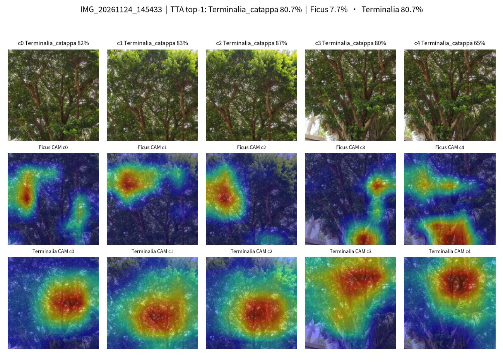
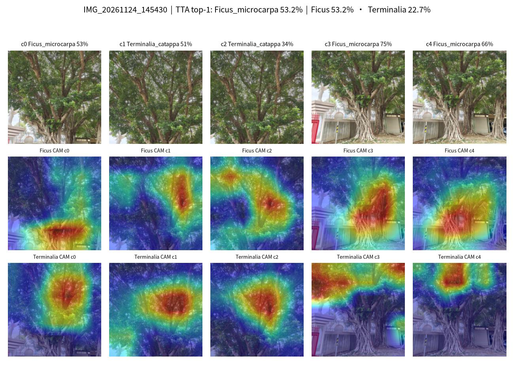
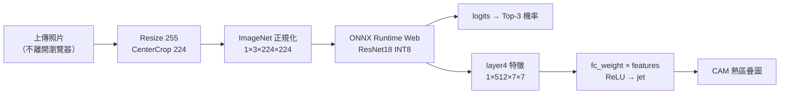

# tree7 · 七種樹種辨識

從資料集建置、基線 CNN、ResNet18 遷移學習、Grad-CAM，到把 INT8 模型放進瀏覽器端推論的完整範例。

**[線上 Demo](https://xieih-tree7-species-classifier.static.hf.space)** ｜ **[Hugging Face Space](https://huggingface.co/spaces/Xieih/tree7-species-classifier)** ｜ **[資料集](https://huggingface.co/datasets/Xieih/tree7)**

## 成果一覽

測試集：隨機 split 214 張、observation split 217 張，7 類。checkpoint 依驗證集 macro F1 選取（early stopping，patience 6）。兩種切分分欄報告，不混用。

| 模型 | 隨機 split acc（歷史） | 隨機 split macro F1（歷史） | observation acc | observation macro F1 | 參數量 |
|---|---|---|---|---|---|
| 基線 CNN（4 卷積塊 + GAP，從零訓練） | 81.78% | 81.76% | 77.42% | 77.18% | 1.18 M |
| ResNet18 遷移學習（ImageNet 預訓練） | 92.99% | 92.95% | 92.63% | 92.66% | 11.18 M |
| └ INT8 靜態量化（QDQ） | 92.99% | 92.96% | **92.63%** | **92.63%** | 11.18 M |
| └ INT8 + 5-crop TTA（Demo） | 94.39% | 94.39% | **93.55%** | **93.54%** | 11.18 M |
| └ ResNet18 + 退化增強 fine-tune | — | — | 92.17% | 92.21% | 11.18 M |

- 隨機切分（**歷史**）：train 1,714 / valid 215 / test 214（分層 80/10/10，seed `20261124`）；不再作為部署依據。
- observation split：依 `manifest.csv` 的 `page_url` 分組，1,729 組、train 1,707 / valid 219 / test 217，0 組跨 split；定義在 [`splits_grouped.csv`](splits_grouped.csv)，統計在 [`grouped_split_stats.json`](results/grouped_split_stats.json)。
- observation split 已重訓、匯出與量化；新 test 只評估一次，輸出在 [`results/observation_split/`](results/observation_split/)。Demo 目前載入的是 grouped INT8 模型（`model.onnx?v=2`），不是隨機 split 的舊模型。
- 量化前後幾乎無落差（grouped）：torch 與 ONNX fp32 的 test accuracy 都是 92.63%，INT8 center 也是 92.63%；TTA 為 93.55%（n=217）。
- 部署門檻改為 **TTA + 0.85**（grouped valid 選出）：grouped test coverage 53.00%、selective accuracy 100%、攔到 14/14 錯誤；UI、config 與護欄表一致。
- 榕樹↔大葉欖仁互判在 observation split 下 center 5 件、TTA 4 件；不與隨機 split 的舊數字直接相減。
- 完整訓練曲線、混淆矩陣、per-class 指標、預測明細會寫到 `runs/`（`curves_*.png`、`confusion_*.png`、`per_class_*.csv`、`predictions_*.csv`、`metrics_test_*.json`）。

## 評估結果

### grouped observation split（部署版，n=217）

以 grouped INT8 ONNX（`demo/model.onnx`，`?v=2`）在 observation split 的 test 上推論；前處理為 `Resize(255) + CenterCrop(224)`，TTA 為中心＋四角共 5 個 224 crop 的平均 logits。這個 test 只評估一次：

| 模式 | accuracy | macro F1 | 錯誤數 | 互判（榕樹↔欖仁） |
|---|---|---|---|---|
| INT8 center | 92.63% | 92.63% | 16 / 217 | 5 |
| INT8 + 5-crop TTA | **93.55%** | **93.54%** | **14 / 217** | 4 |

- 量化前後一致：torch、ONNX fp32、INT8 center 的 grouped test accuracy 都是 92.63%；INT8 沒有可測到的落差。
- 部署門檻為 **TTA + 0.85**（grouped valid 選出）：test coverage 53.00%、selective accuracy 100%、攔到 14/14 錯誤；代價是誤攔 43.35% 的正確樣本。完整權衡見 [`guard_consistency.md`](results/observation_split/guard_consistency.md)。

| 類別 | precision | recall | F1 | support |
|---|---|---|---|---|
| 榕樹 | 0.871 | 0.871 | 0.871 | 31 |
| 大葉欖仁 | 0.853 | 0.935 | 0.892 | 31 |
| 柱狀南洋杉 | 1.000 | 0.935 | 0.967 | 31 |
| 散尾葵 | 0.938 | 0.968 | 0.952 | 31 |
| 鶴望蘭 | 0.968 | 1.000 | 0.984 | 30 |
| 槲蕨 | 0.941 | 1.000 | 0.970 | 32 |
| 紅桑 | 1.000 | 0.839 | 0.912 | 31 |
| **macro avg** | 0.939 | 0.935 | **0.935** | 217 |

主要誤判仍是榕樹與大葉欖仁：TTA 下榕樹 recall 0.871、紅桑 recall 0.839；兩類互判 4 件。輸出在 [`results/observation_split/`](results/observation_split/)：

- [metrics_test_onnx.json](results/observation_split/metrics_test_onnx.json) — center／TTA、fp32／INT8、互判與部署門檻
- [threshold_sweep.md](results/observation_split/threshold_sweep.md)、[guard_consistency.md](results/observation_split/guard_consistency.md)
- [per_class_resnet18_int8.csv](results/observation_split/per_class_resnet18_int8.csv)、[predictions_resnet18_int8.csv](results/observation_split/predictions_resnet18_int8.csv)
- [confusion_resnet18_int8.png](results/observation_split/confusion_resnet18_int8.png)

<details>
<summary>隨機 split 的舊結果（214 張，僅供歷史追溯）</summary>

以舊版隨機 split INT8 模型推論：center accuracy 92.99%、macro F1 92.96%（15 個錯誤）；5-crop TTA 94.39%（12 個錯誤）。舊版部署門檻是 TTA + 0.8。這些數字與 grouped test 不是同一份資料，不能直接相減或宣稱進步／退步。完整輸出仍保留在 [`results/`](results/) 與 [`results/README.md`](results/README.md) 的「隨機 split」段落。

</details>

### observation split（訓練結果）

依 `page_url` 分組、1,729 組、test 217 張，重訓後只評估一次：

| 模型 | accuracy | macro F1 | 互判（榕樹↔欖仁） |
|---|---|---|---|
| 基線 CNN | 77.42% | 77.18% | 5 |
| ResNet18（torch） | 92.63% | 92.66% | 3 |
| INT8 center | 92.63% | 92.63% | 5 |
| INT8 + 5-crop TTA | **93.55%** | **93.54%** | 4 |
| ResNet18 + 退化增強 | 92.17% | 92.21% | 4 |

- 相較隨機 split，基線下降 4.36 個百分點、ResNet18 下降 0.36；基線對同一觀察的重複影像較敏感。
- 榕樹／欖仁互判在 **observation split 下** center 3 件、TTA 4 件；不與隨機 split 的 6 件直接比較。榕樹 recall 仍只有 0.871（31 張中 4 張錯）。
- 退化增強（縮放 0.35–0.7、Gaussian blur、JPEG q30–50）在**乾淨 test** 上是 92.17%，沒有超越原 ResNet18；它是否在手機遠景／壓縮照上較穩，仍待 field-set 分層評估。
- 輸出：[results.json](results/observation_split/results.json)、[per-class](results/observation_split/per_class_resnet18.csv)、[混淆矩陣](results/observation_split/confusion_resnet18.png)、[訓練曲線](results/observation_split/curves_resnet18.png)。

## 現場失敗案例（原圖重跑）

使用者提供的兩張手機照（同一棵榕樹，2026-11-24 14:54）以**新版 grouped INT8 模型**重跑；TTA 為中心＋四角平均，CAM 為每個裁切的 per-crop CAM。

| 原始檔 | center top-1 | TTA top-1 | TTA 榕樹 / 欖仁 | 結果 |
|---|---|---|---|---|
| `IMG_20261124_145430` | 榕樹 53.4% | 榕樹 53.3% | 53.3% / 22.7% | 正確，但遠低於 0.85，會顯示補拍提示 |
| `IMG_20261124_145433` | 大葉欖仁 81.7% | **大葉欖仁 80.7%** | 7.7% / 80.7% | **仍誤判**；TTA 沒有翻回榕樹，且低於 0.85 |

`145433` 的五個裁切這次全部 top-1 都是大葉欖仁（65–87%），不再出現舊模型的裁切矛盾；但整體仍是錯的。也就是說，grouped 模型沒有解決這張現場照，只是把錯誤變得更一致。舊隨機 split 模型的 TTA 曾以 49.0% 翻回榕樹；兩者都是錯的或低信心，不能把舊結果當成新版改善。



*上：五個裁切與各自 top-1；中：Ficus 類的 per-crop CAM；下：Terminalia 類的 per-crop CAM。*

`145430` 仍是低信心正確：center 53.4%、TTA 53.3%，低於 0.85；五個裁切中 c1／c2 偏向欖仁，c0／c3／c4 偏向榕樹。



原始數字、per-crop 機率與舊版對照在 [`field_case_predictions_v2.json`](results/field_case/field_case_predictions_v2.json)；舊版拼圖仍保留在 [`field_case_predictions.json`](results/field_case/field_case_predictions.json) 供追溯。

## 線上 Demo

[https://xieih-tree7-species-classifier.static.hf.space](https://xieih-tree7-species-classifier.static.hf.space)

上傳照片後在**瀏覽器內**完成推論，圖片不會上傳到伺服器：

- Top-3 類別機率與中文名稱
- CAM 熱區（`layer4` 的 7×7 特徵圖 × 分類頭權重；僅反映中心裁切，四角裁切只參與 TTA 機率平均）
- 內建每類一張 test 範例，可直接點選試玩
- top-1 低於 0.85 時顯示低信心提示，並建議補拍葉片、果實或樹皮特寫
- 首次推論使用 5-crop TTA（中心＋四角），約 0.4 秒完成
- 開頁只載入 UI；**第一次推論時**才下載 10.8 MiB 模型與 ORT wasm，之後模型存入瀏覽器 Cache Storage（`tree7-model-v2`），重載不再下載
- ONNX Runtime Web（wasm）搭配 `numThreads=1`，不需要 COOP/COEP 標頭，任何靜態主機都能跑



部署在 Hugging Face **Static Space**：免費帳號無法建立 Gradio／Docker Space（需 PRO），因此改用純靜態托管；把 `demo/` 連同 `model.onnx` 與 `vendor/ort/` 一起上傳即可。

## 專案結構

```text
train.py              # 下載/解包 HF 資料集、訓練基線 CNN 與 ResNet18、測試集評估
gradcam.py            # 兩模型 Grad-CAM 對照、錯誤案例與單張樣本輸出
export_onnx.py        # 匯出 fp32 ONNX、INT8 靜態量化、驗證、產生 demo 資產
demo/                 # 純前端 Demo（HTML/CSS/JS + ONNX Runtime Web）
  model.onnx          # INT8 權重（10.8 MiB，已內附）
  vendor/ort/         # ONNX Runtime Web 的 wasm 執行檔（已內附）
  config.json         # 類別、正規化參數、分類頭權重、驗證指標、範例圖
  examples/           # 每類一張高信心的 test 範例
results/              # 部署版 INT8 模型在 test split 的混淆矩陣、CAM 與 CSV
collect.py            # 建立 iNaturalist / Wikimedia Commons 候選索引
build.py              # 下載、縮邊、dHash 去重，寫入 images/<Label>/*.jpg
repair_manifest.py    # 以磁碟為準重建 manifest 並稽核
manifest.csv          # 2,143 張的來源、授權、座標、觀察日期、頁面連結
classes.json          # 0–6 類別順序與中英學名
species.json          # 物種設定、學名異名對照
```

`runs/` 與 `demo/model_fp32.onnx` 由腳本產生，不納入版本控制；`data/parquet/` 由 `train.py` 首次執行時自動下載；`demo/model.onnx`（int8）與 `demo/vendor/ort/` 已內附，clone 後可直接跑 Demo。

## 快速開始

```bash
pip install -r requirements.txt
pip install torch torchvision matplotlib scikit-learn pyarrow onnx onnxruntime
```

### 訓練

```bash
python3 train.py --prepare-only                                  # 只下載並解包 HF 資料集
python3 train.py --models baseline --epochs 30                   # 基線 CNN
python3 train.py --models resnet18 --transfer-epochs 15 --freeze-epochs 3
```

`train.py` 的預設值：224 px、batch 32、AdamW（weight decay `1e-4`）、label smoothing `0.1`、cosine schedule、patience 6、seed 42。GPU 上自動啟用 AMP；資料集不存在時會自動從 HF 下載（必要時改用 `hf-mirror.com`）。

遷移學習分兩段：前 3 個 epoch 凍結 backbone、只訓練分類頭（lr `1e-3`），之後解凍、backbone lr `1e-4`、分類頭 lr `1e-3`，共 15 個 epoch。基線 CNN 從零訓練約 30 個 epoch。

資料增強：`RandomResizedCrop(0.65–1.0, ratio 0.8–1.25)`、水平翻轉、旋轉 ±10°、ColorJitter（0.2/0.2/0.2/0.05）、ImageNet 正規化；驗證與測試用 resize 255 + center crop 224。

### Grad-CAM

```bash
python3 gradcam.py     # 預設讀 runs/models/<arch>_best.pt、輸出到 runs/gradcam/
```

目標層為 ResNet18 的 `layer4[-1]`、基線 CNN 的 `features[3][3]`。輸出：

- `gradcam_compare.png` — 兩模型在同一批 test 影像上的熱區對照
- `gradcam_errors_resnet18.png`、`gradcam_errors_baseline.png` — 錯誤案例的熱區，用來檢查模型究竟看了哪裡
- `samples/<class>_<arch>.png` — 每類單張大圖
- `gradcam_samples.csv` — 樣本、預測、機率與是否正確

熱圖只用來做模型行為檢查，不構成專業植物鑑定的依據。

### ONNX 匯出與量化

```bash
python3 export_onnx.py --ckpt runs/models/resnet18_best.pt --data-root data/tree7
```

匯出的 wrapper 同時輸出 `logits`（分類）與 `features`（`layer4` 的 `[1, 512, 7, 7]` 特徵圖），讓前端不需另外跑一次模型即可畫 CAM。腳本會：

1. 匯出 fp32 ONNX（opset 17），驗證 torch／ONNX fp32 的 logit 一致性；
2. 用 train 影像做 static QDQ INT8 量化（部署版是 grouped train 128 張；原始 `export_onnx.py` 預設隨機 split 256 張）；
3. 在 test 集上比對 torch、fp32、INT8 三者的 accuracy / macro F1；
4. 寫出 `demo/model_fp32.onnx`、`demo/model.onnx`、`demo/fc_weights.json`、`demo/config.json` 與 7 張 `demo/examples/*.jpg`。

> 部署版由 Kaggle 的 `tree7-export-grouped` kernel 產生：掛載 `tree7-grouped` 的 checkpoint，以 grouped train 校準，並在同一次 grouped test 推論中計算 center／TTA。`export_onnx.py` 保留作為原始隨機 split 的匯出範例，預設不是 grouped。

### 本機跑 Demo

```bash
python3 -m http.server 8000 --directory demo
```

開啟 `http://localhost:8000`。`demo/model.onnx` 與 ORT wasm 已內附，不需額外下載；要重新產生模型與資產時再跑 `python3 export_onnx.py --ckpt runs/models/resnet18_best.pt`。

## 資料集

影像放在 Hugging Face：[`datasets/Xieih/tree7`](https://huggingface.co/datasets/Xieih/tree7) — 2,143 張打包成 parquet（影像嵌在欄位內，附 train/valid/test 切分），不用先抓 500 MB 就能串流訓練。本倉庫以程式、manifest、文件與可直接執行的 Demo 為主；parquet 由 `train.py` 首次執行時自動下載，CC BY-NC 影像公開散布需連署名一併處理。照下面的指令也能在本機重新抓出一份相同結構的資料集；`manifest.csv` 收錄全部 2,143 張的來源連結與授權，可逐張回溯。

| class | 資料夾 | 中文 | 學名 | 張數 |
|---|---|---|---|---|
| 0 | `Ficus_microcarpa` | 榕樹 | *Ficus microcarpa* | 308 |
| 1 | `Terminalia_catappa` | 大葉欖仁（欖仁樹） | *Terminalia catappa* | 307 |
| 2 | `Araucaria_columnaris` | 柱狀南洋杉 | *Araucaria columnaris* | 308 |
| 3 | `Dypsis_lutescens` | 散尾葵（黃椰子） | *Dypsis lutescens* | 303 |
| 4 | `Strelitzia_reginae` | 鶴望蘭（天堂鳥） | *Strelitzia reginae* | 302 |
| 5 | `Drynaria_roosii` | 槲蕨 | *Drynaria roosii* | 309 |
| 6 | `Acalypha_wilkesiana` | 紅桑（威氏鐵莧） | *Acalypha wilkesiana* | 306 |

共 2,143 張、511 MB、最長邊 1024 px、JPEG q88。

### A. 直接載入（推薦）

```python
from datasets import load_dataset

ds = load_dataset("Xieih/tree7")   # train 1714 / valid 215 / test 214
ds["train"][0]["image"]                                 # PIL.Image，存取時才解碼
ds["train"].features["label"].names                    # 0..6 對應上方類別表
```

兩邊倉庫都是 **public**，不需要 token。`label` 是 `ClassLabel`、`image` 是 `Image()` 型別，兩者都由 parquet 內的 Hugging Face feature 簽名決定，不需要載入腳本。切分為分層 80/10/10（seed `20261124`），每個 split 七類皆均衡；`splits.json` 記錄於 HF 倉庫。

### B. 在本機重建資料集

```bash
pip install -r requirements.txt
python3 collect.py --per-source 900   # 建候選索引（只存 metadata，不下載）
python3 build.py --per-label 300      # 下載、縮邊、去重，寫 images/<Label>/*.jpg
python3 repair_manifest.py            # 以磁盤為準重建清單並稽核
```

`build.py` 是增量的：把 `--per-label` 調高只會補抓差額，已存在的影像與 dHash 會被重用。跑完後 `build_parquet.py`（存放在 HF 倉庫根目錄）可把 `images/` ＋ `manifest.jsonl` 打成與 A 相同的 parquet 結構。

### 資料來源與篩選條件

- **iNaturalist**（2,016 張，94.1%）：只取 `quality_grade=research`，即至少兩位專家同意鑑定，標籤可靠度高。抓取順序為「收藏數高→最新」，先取得較完整的株型照。原圖尺寸用 API 回傳的 `original_dimensions` 預篩（長邊 <900 px 排除），不會浪費頻寬下載縮圖。
- **Wikimedia Commons**（127 張，5.9%）：依物種分類頁抓取，標題黑名單排除地圖、插圖、標本掃描、書頁（BHL／CHS）、海報春聯等；另有「標題屬名 ≠ 目標屬名即排除」的檢查（含學名異名對照，見 `species.json` 的 `syn_genera`），用來攔住混入別種分類頁的檔案。
- **GBIF 未納入**：其 media 多為標本掃描與文獻縮圖，對活體植株辨識價值低。

去重採 64-bit dHash、漢明距離 ≤6；跨類比對目前為 0 組近似重複，代表沒有同一張照片被掛到兩個物種。

### manifest.csv 欄位

`file`, `label`, `class_index`, `zh_name`, `sci_name`, `source`, `image_id`, `w`, `h`, `orig_w`, `orig_h`, `bytes`, `license`, `commercial_ok`, `attribution`, `grade`, `faves`, `latlng`, `observed_on`, `page_url`, `image_url`

訓練時較有用的幾個：

- `page_url` — 原始觀察／檔案頁，可回溯驗證標籤
- `grade`／`faves` — 鑑定等級與人氣，可做加權或再過濾
- `latlng`／`observed_on` — 要按地理或季節切 train/val 時用得到
- `commercial_ok` — 見下方授權說明

資料夾即標籤，`torchvision.datasets.ImageFolder`、`tf.data.Dataset.list_files` 或 HuggingFace `datasets` 都能直接載入；`classes.json` 提供 0–6 的類別順序。

## 授權

影像授權逐張不同，`manifest.csv` 已如實記錄：

| 授權 | 張數 |
|---|---|
| CC BY-NC | 1,879 |
| CC BY-SA（含各版本） | 82 |
| CC0 | 81 |
| CC BY（含各版本） | 76 |
| CC BY-NC-SA | 10 |
| CC BY-NC-ND | 6 |
| CC BY-ND | 4 |
| Public domain | 4 |
| FAL | 1 |

本倉庫的程式與文件採 MIT 授權；**影像的授權屬於原上傳者，不在本倉庫的授權範圍內**。CC BY-NC 不可用於商業目的、CC BY／BY-SA 需要署名（`attribution` 欄位即為所需字串）。若之後要商用，用 `commercial_ok == "yes"` 過濾（246 張），並保留 `attribution`。模型權重由這批 CC BY-NC 為主的影像訓練而來，Demo 與權重同樣僅供非商業使用（CC BY-NC 4.0）。

## 已知限制

1. **只有 7 類**：不在類別內（含同屬其他種）的植物，模型仍會給出其中一類的機率，Demo 不具備真正的「未知」拒絕能力；top-1 < 0.85 只是低信心護欄。
2. **整株遠景不可靠**：test 隨機切分以葉片特寫為主，整株／樹冠照的現場表現明顯較差。榕樹與大葉欖仁會互判——實際案例中，一張整株榕樹被預測為大葉欖仁 73.6%（榕樹僅 14.4%）。中心裁切 224×224 會丟掉葉形、果實與樹皮等關鍵特徵；5-crop TTA 只能小幅改善，無法修正這類分佈外照片。
3. **取景混雜**：整株、樹冠、葉／果特寫都有，榕樹類約 4 成是葉近拍。做「通用」辨識是好事，做整株專用模型時需再過濾一輪。
4. **情境偏城市**：多為公園、路樹、校園、庭園，森林原生境與遠景小樹覆蓋率低。
5. **地理偏斜**：熱帶與南半球觀察量大，台灣本地占比有限。要強化台灣街景，可用 iNaturalist 的 `place_id` 限定台灣再抓一輪。
6. **解析度上限**：iNaturalist `large` 檔為長邊 1024 px；要原圖請加 `--inat-size original`（檔案量約 5 倍）。
7. **僅供教學展示**：不能取代專業植物鑑定。
8. **隨機 split 偏樂觀**：`manifest.csv` 有 414 組 `page_url` 含 2 張圖。observation split 重訓後，ResNet18 從 92.99% 降到 92.63%、基線從 81.78% 降到 77.42%，顯示隨機切分確實高估了基線的表現。
9. **退化增強的效益未定**：clean test 只有 92.17%，低於原 ResNet18 的 92.63%；尚不能宣稱在手機遠景／壓縮照上更穩。等 field-set 到位後，再按取景×域分層回報。
10. **現場照仍未解決**：新版 grouped 模型在 `IMG_20261124_145433` 上 TTA 80.7% 仍判成大葉欖仁；`145430` 雖正確但只有 53.3%。0.85 護欄會要求補拍，但這還不是辨識成功。

## 擴大抓取

各物種 iNaturalist 的 research 級池量：榕樹 11,404、大葉欖仁 14,714、柱狀南洋杉 3,048、散尾葵 1,718、槲蕨 1,864、紅桑 1,731、鶴望蘭 769。

每類 500 張：`collect.py --per-source 1600` 再 `build.py --per-label 500`。鶴望蘭會先到頂，要更多就必須放寬到 `needs_id`，標籤品質隨之下降，需人工複核。
